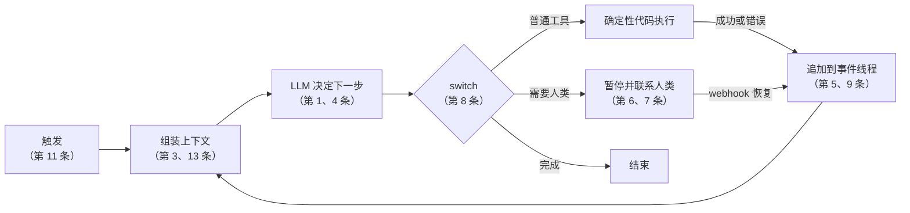

## 一句话导读

这是一份“生产级智能体工程清单”。作者在打造 HumanLayer 的过程中，自述试遍了主流智能体框架，并和上百位想让现有产品“更智能体化”的 SaaS 开发者交流过。它的态度鲜明：**别把一切交给框架和“工具调用循环”，把提示、上下文、控制流和状态都握在自己手里**。读它，是从“会搭智能体”走到“敢上线智能体”的关键一步。

## 为什么放在这个阶段

- **实战阶段第一篇**：体系阶段读完多智能体研究系统后，你已经掌握了模式、工具、上下文和评测。12-Factor 把这些知识重新组织成**工程约束**（状态、暂停与恢复、人工审批、错误处理），正好用来引出后面的长时 harness、Managed Agents 和安全笔记。
- 它对 Anthropic 文章既有呼应也有批评（README 直接拿 Building effective agents 中“智能体”那一节当反例），适合锻炼批判性阅读。

## 结构速览

| 部分 | 核心主张（笔者概括） |
|---|---|
| README | 市面上很多“智能体”其实大部分是确定性代码，只在关键处嵌入 LLM；与其从框架起步，不如把模块化的原则融入已有产品 |
| 软件简史 | 从流程图、DAG 编排器到“智能体循环”的承诺；现实是工具调用循环超过 10–20 轮就容易乱成一团、难以恢复；目前有效的做法是在确定性 DAG 里嵌入小型智能体（举了带人工审批的部署机器人为例）；把智能体拆成四件事：提示、对 LLM 输出做分发的 switch、累积的上下文、循环 |
| 1 自然语言 → 工具调用 | LLM 最原子的作用：把自然语言转成结构化调用，再交给确定性代码执行 |
| 2 掌控你的提示 | 不要把提示外包给框架的黑盒抽象；把提示当一等代码对待，便于测试、评测和迭代 |
| 3 掌控你的上下文窗口 | 不必拘泥于标准消息格式，可以把“到目前为止发生了什么、下一步做什么”编码成自定义的事件线程（比如用 XML/YAML 片段放进一条消息），追求信息密度；可以隐藏已解决的错误、过滤敏感信息 |
| 4 工具只是结构化输出 | 工具调用本质是一段 JSON，执行交给确定性代码；“决定做什么”和“怎么做”分开 |
| 5 统一执行状态与业务状态 | 尽量从事件线程推导出当前步骤、等待状态等，减少额外的状态表；这样更容易序列化、调试、恢复和分叉 |
| 6 用简单 API 启动 / 暂停 / 恢复 | 智能体应该能被外部触发、在长任务或等待人类时暂停、通过 webhook 等方式恢复；特别要能在“选好工具”和“执行工具”之间暂停 |
| 7 用工具调用联系人类 | 把“请求人类输入或审批”也设计成一种结构化工具调用（带紧急程度、期望格式等），让智能体之间、智能体与人之间的交互走同一套机制 |
| 8 掌控你的控制流 | 自己写循环，就能自由决定何时同步继续、何时中断等待澄清或审批，并加入摘要、LLM 评审、压缩、追踪、限流等；作者说用户最常提的需求就是“在选工具和执行之间打断” |
| 9 把错误压缩进上下文 | 把错误信息简洁地放回上下文，让模型自我修复；设错误计数上限（文中示例约 3 次），超过就升级给人 |
| 10 小而专注的智能体 | 一个智能体只做一件事，步骤控制在几步到十几步；随着模型变强，再逐步扩大范围 |
| 11 从任何地方触发 | 让用户通过 Slack、邮件、短信等渠道触发智能体，也让智能体在这些渠道里找人；支持“外循环”智能体，高风险操作有人把关（这一节含作者公司产品的介绍） |
| 12 无状态 reducer | 把智能体看作对事件序列做折叠（fold）的纯函数；作者自称这一条主要是为了好玩，正文几乎只有图 |
| 附录 13 预取上下文 | 如果下一步大概率需要某些信息，就由确定性代码先取来放进上下文，而不是让模型多绕一轮工具调用 |

## 建议看哪些部分

| 优先级 | 部分 | 理由 |
|---|---|---|
| 必看 | [README](https://github.com/humanlayer/12-factor-agents) 与 [软件简史](https://github.com/humanlayer/12-factor-agents/blob/main/content/brief-history-of-software.md) | 理解作者的立场：“智能体 = 大部分软件 + 少量 LLM 决策” |
| 必看 | [第 3 条 上下文窗口](https://github.com/humanlayer/12-factor-agents/blob/main/content/factor-03-own-your-context-window.md) | 和 Anthropic 上下文工程对照阅读的最佳材料 |
| 必看 | [第 8 条 控制流](https://github.com/humanlayer/12-factor-agents/blob/main/content/factor-08-own-your-control-flow.md) 与 [第 7 条 联系人类](https://github.com/humanlayer/12-factor-agents/blob/main/content/factor-07-contact-humans-with-tools.md) | 人工审批与中断是生产上线的关键 |
| 必看 | [第 10 条 小而专注](https://github.com/humanlayer/12-factor-agents/blob/main/content/factor-10-small-focused-agents.md) | 与多智能体、长时 harness 的设计取舍直接相关 |
| 推荐 | 第 [5](https://github.com/humanlayer/12-factor-agents/blob/main/content/factor-05-unify-execution-state.md)、[6](https://github.com/humanlayer/12-factor-agents/blob/main/content/factor-06-launch-pause-resume.md)、[9](https://github.com/humanlayer/12-factor-agents/blob/main/content/factor-09-compact-errors.md) 条，[附录 13](https://github.com/humanlayer/12-factor-agents/blob/main/content/appendix-13-pre-fetch.md) | 状态、恢复、错误处理的具体手法 |
| 选看 | 第 1、2、4、11 条 | 概念直接，快速浏览即可；第 11 条含产品介绍 |
| 可略 | [第 12 条](https://github.com/humanlayer/12-factor-agents/blob/main/content/factor-12-stateless-reducer.md) | 作者自称“为了好玩”，正文只有图 |

## 与 Anthropic 笔记对照

| 12-Factor | Anthropic 笔记 | 关系 |
|---|---|---|
| README：好的智能体大部分是软件 | [构建高效的智能体](./building-effective-agents.md) | **表面分歧、实质接近**：12-Factor 把 Anthropic 文中“自主智能体”一节当作反例；但 Anthropic 同样主张“能用工作流就别用智能体、少依赖框架”。差别在于 12-Factor 更进一步，主张即使是智能体也要拆进确定性流程 |
| 第 3 条 上下文窗口 | [上下文工程](./effective-context-engineering-for-ai-agents.md) | **高度一致**：都把上下文当成需要精心设计的稀缺资源。12-Factor 更强调自定义格式和信息密度，Anthropic 更强调压缩、笔记、子智能体 |
| 附录 13 预取 | [上下文工程](./effective-context-engineering-for-ai-agents.md) 中的“即时检索 vs 预先检索 / 混合策略” | **可以对话**：12-Factor 偏向确定性预取，Anthropic 认为趋势是即时检索，同时承认混合策略的价值 |
| 第 5、6、12 条 状态与恢复 | [Managed Agents](./managed-agents.md)、[长时运行智能体的有效 harness](./effective-harnesses-for-long-running-agents.md) | **一致**：Managed Agents 把会话做成只追加的事件日志，harness 可以随时 `wake` 并从最后一个事件继续，几乎就是第 5、6 条的平台级实现；长时 harness 用进度文件和 git 历史跨窗口接续 |
| 第 7、8 条 人工介入与控制流 | [auto 模式](./claude-code-auto-mode.md)、[超越权限弹窗](./claude-code-sandboxing.md) | **互补**：12-Factor 主张在“选工具”和“执行”之间暂停交给人；Claude Code 的 auto 模式尝试用分类器替代部分人工审批，沙箱则缩小需要审批的范围 |
| 第 10 条 小而专注 | [多智能体研究系统](./multi-agent-research-system.md)、[面向长时应用开发的 harness 设计](./harness-design-long-running-apps.md) | **部分一致**：Anthropic 也把任务拆给子智能体或角色（规划、生成、评估），但同时在探索能长时间自主运行的大任务；第 10 条自己也说范围会随模型能力扩大 |
| 第 9 条 压缩错误 | [为智能体编写高效工具](./writing-tools-for-agents.md) | **一致**：让工具返回对模型有用的错误信息，是自我修复的前提 |

## 学习任务

1. 用第 3 条的思路，把你的结业智能体的上下文从“标准消息列表”改写成自定义事件线程格式，比较 token 数和效果。
2. 在你的循环里加一个“执行前暂停”的分支：遇到写操作时先发起人工确认（第 7、8 条），再对照 Claude Code auto 模式笔记，想想哪些确认可以交给分类器。
3. 写一页短评：12-Factor 对 Anthropic“智能体”一节的批评，你同意几分？请引用至少两篇 Anthropic 笔记作为论据。

## 注意事项

- **作者立场**：作者在打造 HumanLayer，第 11 条明确包含该产品的介绍，阅读时注意区分原则与推广。
- **时效**：仓库最后推送于 2025-09；README 明确不讨论 MCP，也不涉及 2025 年下半年以后的平台能力（比如托管的会话与沙箱）。
- **代码**：示例多为 TypeScript 伪代码，部分用 BAML，读懂思路即可，不必照搬。
- **许可**：文字与图片采用 CC BY-SA 4.0。本导读未转载任何原文图片，如需引用请遵守署名—相同方式共享的要求。

## 关键原话

> "Agents, at least the good ones, ... are comprised of mostly just software."
> （好的智能体，大部分其实就是软件。）

## 延伸阅读

**站内笔记**
- [面向 AI 智能体的上下文工程](./effective-context-engineering-for-ai-agents.md)
- [扩展 Managed Agents](./managed-agents.md)
- [我们如何构建 Claude Code auto 模式](./claude-code-auto-mode.md)

**站内资源**
- [Chip Huyen《Agents》导读](./r-chip-huyen-agents.md)：规划与执行解耦
- [OpenAI Cookbook 导读](./r-openai-cookbook.md)：另一家厂商在状态、记忆、沙箱上的做法

---

*本导读依据 2026-10-17 访问的在线内容撰写，仅为导读与总结。原文：Dex（HumanLayer）,《12-Factor Agents》, <https://github.com/humanlayer/12-factor-agents>。*
