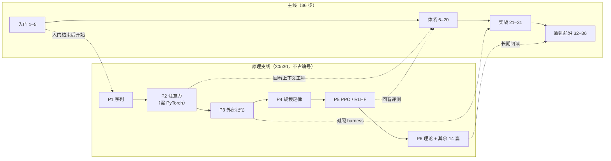

> **定位提示**：这是一条**并行的原理支线**，不占主线编号。它回答的不是“智能体怎么搭”，而是“智能体底下的模型是怎么来的”。

## 一句话导读

30u30 把 30 篇经典论文做成了“读讲解 → 看实现 → 做练习”的学习单元。跟着它走一遍，你会知道上下文窗口、注意力、采样、规模定律、RLHF 这些在 Anthropic 笔记里反复出现的词，**在模型内部究竟是什么**。

## 为什么放在这个阶段

- **起点在入门之后**：主线第 1–5 步结束时，你已经会用模型、会搭简单智能体，这时回头追问“模型为什么这样工作”最有动机。所以 P1 挂在 [Claude Code 最佳实践](./claude-code-best-practices.md) 之后。
- **并行而不前置**：做智能体工程不需要先会实现 Transformer。把它设成前置，会把“能动手”的时间推后好几个月，所以作为可选支线，与体系、实战、跟进前沿三个阶段并行推进。
- **有汇合点**：几篇笔记的关键论点直接依赖底层原理。比如 [上下文工程](./effective-context-engineering-for-ai-agents.md) 用“n 个 token 有 n² 对关系”解释上下文为什么是有限预算；[三个问题的事后复盘](./a-postmortem-of-three-recent-issues.md) 涉及 top-k / top-p 采样。支线各段的时机就是按这些汇合点安排的。

## 结构速览

仓库把 30 篇分为 6 个单元（篇名为笔者简称，括号内为 Day 编号）：

| 单元 | 论文 |
|---|---|
| 1 基础：序列与压缩 | Karpathy 谈 RNN 的有效性（1）· Olah 讲 LSTM（2）· RNN 正则化（3）· 最小描述长度（4）· MDL 教程（5）· 复杂动力学第一定律（6）· 咖啡自动机（7） |
| 2 深度学习爆发：视觉 | AlexNet（8）· ResNet（9）· ResNet v2（10）· 空洞卷积（11）· Dropout（12） |
| 3 Transformer 时代 | Attention Is All You Need（13）· The Annotated Transformer（14）· Bahdanau 注意力（15）· Order Matters（16） |
| 4 专门架构：记忆与图 | 神经图灵机（17）· 指针网络（18）· 关系推理模块（19）· 关系 RNN（20）· 神经消息传递（21）· Deep Speech 2（22） |
| 5 生成模型与规模 | 变分有损自编码器（23）· GPipe（24）· 规模定律（25）· Kolmogorov 复杂性（26）· Legg《机器超级智能》（27）· CS231n（28） |
| 6 强化学习与对齐 | PPO（29）· 基于人类偏好的深度强化学习（30） |

**每篇的配套内容**（按仓库文件树核对）：讲解 README（标有预计时长和前置要求）、简版笔记、速查表、完整实现、最小训练脚本、可视化脚本、notebook，以及练习和答案（多数 5 道，Day 19 有 7 道）。视觉单元前 4 篇另有自测题目录。

**实现用的库**（按各篇 `implementation.py` 的导入判断）：
- 只用 NumPy 或标准库的约 12 篇：Day 1–7、12、13、26–28。
- 用到 PyTorch 的约 18 篇：Day 8–11、14–25、29、30。

**前置要求**：总 README 说初学者有 Python 基础即可，不需要 GPU。但各篇要求逐步升高：第 3 单元起多篇要求 PyTorch 和线性代数，PPO 要求强化学习基础。本路线**从 P2（注意力）起把 PyTorch 基础列为前置**。

## 建议看哪些部分

30 篇全部推荐。下面是笔者建议的顺序：核心 10 篇按 P1–P5，理论 6 篇为 P6，其余 14 篇按原单元补完。

| 优先级 | 段 | 论文（Day） | 时机（主线步号） | 前置 |
|---|---|---|---|---|
| 核心 | P1 序列与预测下一个 token | [1](https://github.com/Ojhaharsh/30u30/tree/main/papers/01_Unreasonable_Effectiveness)、[2](https://github.com/Ojhaharsh/30u30/tree/main/papers/02_Understanding_LSTM) | 入门结束后，与第 6–7 步同期 | Python、一点微积分 |
| 核心 | P2 注意力与 Transformer | [15](https://github.com/Ojhaharsh/30u30/tree/main/papers/15_bahdanau_attention) → [13](https://github.com/Ojhaharsh/30u30/tree/main/papers/13_attention) → [14](https://github.com/Ojhaharsh/30u30/tree/main/papers/14_annotated_transformer) | 第 8–13 步期间 | **PyTorch 基础**、线性代数 |
| 核心 | P3 外部记忆与指针 | [17](https://github.com/Ojhaharsh/30u30/tree/main/papers/17_neural_turing_machines)、[18](https://github.com/Ojhaharsh/30u30/tree/main/papers/18_pointer_networks) | 第 14–20 步期间 | PyTorch、注意力 |
| 核心 | P4 规模定律 | [25](https://github.com/Ojhaharsh/30u30/tree/main/papers/25_scaling_laws) | 第 21–24 步期间 | PyTorch、Transformer |
| 核心 | P5 PPO 与 RLHF | [29](https://github.com/Ojhaharsh/30u30/tree/main/papers/29_PPO) → [30](https://github.com/Ojhaharsh/30u30/tree/main/papers/30_RLHF) | 第 25–31 步期间 | PyTorch、强化学习基础 |
| 理论 | P6 压缩、复杂性、通用智能 | [4](https://github.com/Ojhaharsh/30u30/tree/main/papers/04_Minimizing_Description_Length)、[5](https://github.com/Ojhaharsh/30u30/tree/main/papers/05_MDL_Principle)、[26](https://github.com/Ojhaharsh/30u30/tree/main/papers/26_kolmogorov_complexity) · [6](https://github.com/Ojhaharsh/30u30/tree/main/papers/06_Complexodynamics)、[7](https://github.com/Ojhaharsh/30u30/tree/main/papers/07_coffee_automaton) · [27](https://github.com/Ojhaharsh/30u30/tree/main/papers/27_MSI) | 实战之后，与跟进前沿并行 | 概率、离散数学 |
| 补完 | 单元 1 | [3](https://github.com/Ojhaharsh/30u30/tree/main/papers/03_RNN_Regularization) | P1 之后 | 同 P1 |
| 补完 | 单元 2 视觉 | [8](https://github.com/Ojhaharsh/30u30/tree/main/papers/08_alexnet) → [9](https://github.com/Ojhaharsh/30u30/tree/main/papers/09_resnet) → [10](https://github.com/Ojhaharsh/30u30/tree/main/papers/10_resnet_v2) → [11](https://github.com/Ojhaharsh/30u30/tree/main/papers/11_dilated_convolutions) → [12](https://github.com/Ojhaharsh/30u30/tree/main/papers/12_dropout) | 跟进前沿期间 | PyTorch（Day 12 只用 NumPy） |
| 补完 | 单元 3 | [16](https://github.com/Ojhaharsh/30u30/tree/main/papers/16_order_matters) | P2 之后 | PyTorch |
| 补完 | 单元 4 | [19](https://github.com/Ojhaharsh/30u30/tree/main/papers/19_relational_reasoning) → [20](https://github.com/Ojhaharsh/30u30/tree/main/papers/20_Relational_RNNs) → [21](https://github.com/Ojhaharsh/30u30/tree/main/papers/21_Neural_Message_Passing) → [22](https://github.com/Ojhaharsh/30u30/tree/main/papers/22_deep_speech_2) | 跟进前沿期间 | PyTorch |
| 补完 | 单元 5 | [23](https://github.com/Ojhaharsh/30u30/tree/main/papers/23_variational_lossy_autoencoder) → [24](https://github.com/Ojhaharsh/30u30/tree/main/papers/24_gpipe) → [28](https://github.com/Ojhaharsh/30u30/tree/main/papers/28_CS231n) | 跟进前沿期间（28 也可以提前，作为 CNN 入门） | PyTorch（Day 28 只用 NumPy） |

**每篇怎么读**：有经验的读者可以走“讲解 README → 实现代码 → 练习”；时间紧时只读讲解和速查表，跳过训练与练习。仓库的 QUICKSTART 也给了“理论优先 / 代码优先 / 练习优先”三条路径。

**时长**（除标明“仓库”的数字外，均为笔者估算）：

| 口径 | 数字 |
|---|---|
| 仓库口号 | “30 天 30 篇”；QUICKSTART 建议每天约 2–3 小时 |
| 仓库各篇标注时长加总 | **110–156 小时**（核心 10 篇 38–55 小时，P6 20–29 小时，其余 14 篇 52–72 小时） |
| 每周 5–6 小时 | 全部约 **5–8 个月**：核心 10 篇约 8–12 周，与体系、实战并行 |
| 每周约 10 小时 | 全部约 **3–4 个月** |

frontmatter 里的 `estimated_hours: 133` 取的是仓库加总区间的中值，同样只是估算。

## 与 Anthropic 笔记对照

| 支线段 | 搭配笔记 | 怎么对照 |
|---|---|---|
| P1 | [近期三个问题的事后复盘](./a-postmortem-of-three-recent-issues.md)（前向链接） | 先弄懂模型如何一次采样一个 token、温度如何影响输出，再看复盘里 top-k / top-p 采样和输出损坏的问题，会具体得多 |
| P2 | [面向 AI 智能体的上下文工程](./effective-context-engineering-for-ai-agents.md)（回看） | 亲手算一遍注意力之后，再读“n 个 token 有 n² 对关系、上下文越长注意力越摊薄”，就不再是抽象说法 |
| P3 | [长时运行智能体的有效 harness](./effective-harnesses-for-long-running-agents.md) | 神经图灵机在网络内部学会读写外部记忆；harness 则在系统外部用进度文件和笔记充当记忆。两者**只是类比**，比较其差异本身就是收获 |
| P4 | [面向长时应用开发的 harness 设计](./harness-design-long-running-apps.md)、[12-Factor Agents 导读](./r-12-factor-agents.md) | 规模定律说明能力会随规模可预测地提升；harness 笔记提醒“每个组件都编码了对模型能力的假设，会随模型进步而过时”；12-Factor 第 10 条主张随模型变强逐步扩大智能体范围 |
| P5 | [揭秘 AI 智能体评测](./demystifying-evals-for-ai-agents.md)（回看） | RLHF 的奖励模型从人类偏好里学习“什么是好”；评测里的模型评分器也在近似人类判断。两者可以类比，各自的局限也相似 |
| P6 | [构建高效的智能体](./building-effective-agents.md)、[Chip Huyen 导读](./r-chip-huyen-agents.md)、[Simon Willison 导读](./r-simon-willison.md) | Legg 用“智能体—环境”循环形式化定义智能；工程文章则用“在循环中使用工具”来定义智能体。把两种定义放在一起比较 |

## 学习任务

1. 读完 P1 后，用你常用的模型 API 把温度分别设为 0、0.7、1.2，各采样同一个提示若干次，记录输出差异，再去读事后复盘。
2. 读完 P2 后，估算一下：你的结业智能体上下文从 10k token 涨到 100k token 时，注意力的“成对关系”增加了多少倍？这对你的上下文压缩策略意味着什么？
3. 读完 P5 后，写一段对比：RLHF 的奖励模型和你在评测里用的模型评分器，分别可能在哪些情况下“被钻空子”？
4. 每读完一个单元，用三句话写下“这篇和智能体工程有什么关系”。如果答案是“关系不大”，也照实记录。

## 注意事项

- **书单来源**：本页统一写作“**据称源自 Ilya 推荐书单（未经本人证实），仓库另补 3 篇**”。
  - 网上流传的“Ilya Sutskever 给 John Carmack 的书单”公开版本只有 27 项，从未经本人确认。参见 [30papers.com](https://30papers.com/) 与 [Tensorlabbet 的讨论](https://tensorlabbet.com/2024/11/11/lost-reading-items/)。
  - 对照这 27 项，30u30 另补了 Dropout（Day 12）、PPO（Day 29）、RLHF（Day 30），但仓库没有标明这一点。
  - 常被引用的“学会这些就懂了 90%”一句，出处同样未经证实。
- **不全是 NumPy**：约 18 篇用到 PyTorch，网站卡片上的技术标签与代码也不完全一致，以各篇代码为准。
- **授权 CC BY-NC-ND 4.0**：可以阅读、学习、分享链接；不能商用，不能分发改编版本。所以本站不提供中文翻译或改写版，代码、讲解和练习请到原仓库查看。
- **正确性**：讲解和实现由个人维护，本导读没有逐篇核对，建议对照原论文阅读（原论文链接见仓库的 [`ilya_30_papers.md`](https://github.com/Ojhaharsh/30u30/blob/main/ilya_30_papers.md)）。
- **小问题**：README 快速开始里的克隆地址写成了占位符 `yourusername`，实际地址是 `github.com/Ojhaharsh/30u30`。另外，`ilya_30_papers.md` 的 AlexNet 条目下多挂了一个 arXiv 1211.5063 链接，那是另一篇论文（关于 RNN 训练难点）。
- **时效**：仓库最后推送是 2026-02-19（北京时间），Bonus 论文（BERT、GPT-2、GPT-3、Chinchilla 等）标为即将推出，尚未上线。

## 延伸阅读

**站内笔记**
- [面向 AI 智能体的上下文工程](./effective-context-engineering-for-ai-agents.md)
- [近期三个问题的事后复盘](./a-postmortem-of-three-recent-issues.md)
- [揭秘 AI 智能体评测](./demystifying-evals-for-ai-agents.md)

**站内资源**
- [Lilian Weng 综述导读](./r-lilian-weng-llm-agents.md)：从研究脉络看智能体组件
- [Hugging Face 课程导读](./r-hf-agents-course.md)：主线练手项目

**原文相关链接**
- 配套网站：<https://ojhaharsh.github.io/30u30/>
- 论文清单：<https://github.com/Ojhaharsh/30u30/blob/main/ilya_30_papers.md>
- 授权全文：<https://creativecommons.org/licenses/by-nc-nd/4.0/>

---

*本导读依据 2026-10-18 访问的在线内容撰写，仅为导读与总结。原文：Harsh Ojha,《30u30: Master Ilya's 30 Foundational AI Papers in 30 Days》, <https://github.com/Ojhaharsh/30u30>。*
