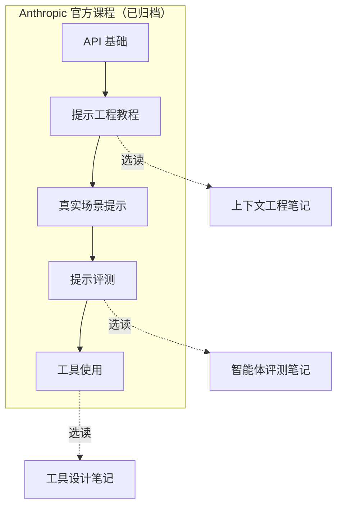

> **状态提示**：这套课程**已归档**，内容偏旧。本路线把它**降为选读**，只建议挑章节补基本功。

## 一句话导读

这是 Anthropic 自己写的五门 Jupyter notebook 课程，覆盖从“怎么发第一个请求”到“怎么给提示写评测”。概念部分至今有用，但代码细节已经停止更新。

## 为什么放在这个阶段

- **入门（选读）**：读完 [构建高效的智能体](./building-effective-agents.md) 后，如果对 Messages API 的格式、参数或提示写法还不熟，可以挑 API 基础和提示工程教程的相关章节补课。读完 [上下文工程](./effective-context-engineering-for-ai-agents.md) 后，可以用 Tool use 课程动手体验一次完整的工具调用。
- **体系（选读）**：评测笔记之前，Prompt evaluations 课程能提供“人工打分 → 代码打分 → 模型打分”的一套动手练习。
- **为什么不当主线**：仓库已归档，示例模型老，[Hugging Face 课程](./r-hf-agents-course.md)和当前官方文档覆盖了大部分入门需求。

## 结构速览

README 建议按以下顺序学习：

| 顺序 | 课程 | 内容（笔者概括） |
|---|---|---|
| 1 | API fundamentals | 获取 API key、消息格式、模型选择、参数、流式输出、多模态（图像）提示 |
| 2 | Prompt engineering interactive tutorial | 9 章 + 附录：基本结构、清晰直接、角色、数据与指令分离、输出格式与预填、先思考再回答、示例、避免幻觉、复杂提示综合练习；附录涉及提示链、工具使用、搜索与检索 |
| 3 | Real world prompting | 5 课：回顾后用医疗、流程、通话摘要、客服等场景练习写长而复杂的提示 |
| 4 | Prompt evaluations | 9 课：评测基础、Workbench 人工打分、代码打分、分类评测、promptfoo 入门与分类、自定义 grader、模型打分、自定义模型打分 |
| 5 | Tool use | 6 课：概览、第一个工具、用工具强制 JSON 输出、完整工具调用流程、tool choice、多工具聊天机器人 |

## 建议看哪些部分

| 优先级 | 部分 | 理由 |
|---|---|---|
| 选看 | [Prompt engineering 教程](https://github.com/anthropics/courses/tree/master/prompt_engineering_interactive_tutorial) 的“数据与指令分离”“先思考再回答”“示例”“避免幻觉”几章 | 这几章的概念跟模型版本关系最小，又和上下文工程直接相关 |
| 选看 | [Tool use](https://github.com/anthropics/courses/tree/master/tool_use) 第 2–5 课 | 用最小例子走一遍“模型提出调用 → 你的代码执行 → 回传结果”，配合 [为智能体编写高效工具](./writing-tools-for-agents.md) 阅读 |
| 选看 | [Prompt evaluations](https://github.com/anthropics/courses/tree/master/prompt_evaluations) 中代码打分、模型打分两课 | 为 [揭秘 AI 智能体评测](./demystifying-evals-for-ai-agents.md) 中的 grader 分类提供动手体验 |
| 可略 | API fundamentals（若已会调 API）、Real world prompting | 前者看官方文档更新更快；后者偏单轮长提示，与智能体主线距离较远 |

## 与 Anthropic 笔记对照

- **从单轮提示到上下文**：提示工程教程关心“一次提示怎么写”，[上下文工程](./effective-context-engineering-for-ai-agents.md) 把视角扩展到“多轮循环里，什么信息该留在上下文中”。读教程时可以思考：哪些技巧在长时智能体里依然成立，哪些需要改写。
- **工具**：Tool use 课程讲的是调用机制，[为智能体编写高效工具](./writing-tools-for-agents.md) 讲工具的设计与评测；[think 工具](./claude-think-tool.md) 则是“用工具来塑造推理”的进一步例子。
- **评测**：Prompt evaluations 课程停留在“提示级”评测；[揭秘 AI 智能体评测](./demystifying-evals-for-ai-agents.md) 讨论多轮、带工具的智能体评测，难度更高。

## 学习任务

1. 从提示工程教程里挑两条技巧，各写一个“单轮提示版”和一个“智能体系统提示版”，比较措辞需要怎么变。
2. 用 Tool use 课程的最小示例，换成当前官方文档里的模型名重新跑通，并记下你改了哪些地方（这本身就是在练“识别过时内容”）。
3. 用 Prompt evaluations 的思路，为一个小提示写 5 条代码打分用例和 1 个模型打分 rubric。

## 注意事项

- **已归档**：仓库不再更新，模型名、SDK 写法和控制台界面可能与现在不同，**以当前官方文档为准**。
- **费用**：README 只说明课程偏向使用低成本模型以节省 API 费用。运行 notebook 需要自己的 API key，具体费用本导读不作说明。
- **工具依赖**：Prompt evaluations 部分使用 promptfoo，版本变化可能导致命令不同。

## 延伸阅读

**站内笔记**
- [构建高效的智能体](./building-effective-agents.md)
- [面向 AI 智能体的上下文工程](./effective-context-engineering-for-ai-agents.md)
- [为智能体编写高效工具](./writing-tools-for-agents.md)
- [揭秘 AI 智能体评测](./demystifying-evals-for-ai-agents.md)

**站内资源**
- [Hugging Face 课程导读](./r-hf-agents-course.md)：入门主线

---

*本导读依据 2026-10-17 访问的在线内容撰写，仅为导读与总结。原文：Anthropic,[《Anthropic courses》](https://github.com/anthropics/courses)。*
