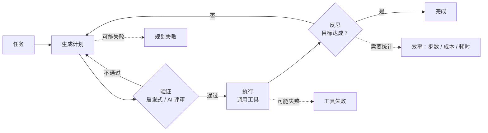

## 一句话导读

如果说 Anthropic 的 [构建高效的智能体](./building-effective-agents.md) 是一份“模式清单”，那么 Chip Huyen 这篇讲的是**“为什么这样做有效、规划怎么做、会怎样失败”**。它是体系阶段里把概念落到工程判断上的关键一篇。

## 为什么放在这个阶段

- 紧接 [Lilian Weng 的综述](./r-lilian-weng-llm-agents.md)，两者都排在体系阶段开头：Weng 给出组件地图，Huyen 回答“组件之间怎么配合、出错时怎么看”。
- 它为体系阶段接下来的工具组笔记（think 工具、MCP、高级工具使用）和评测组笔记提供了统一的分析语言：**工具类型 → 规划 → 失败模式**。
- 作者明确把自己的写法和 Anthropic 那篇做了比较，很适合当作对照阅读的材料。

## 结构速览

| 部分 | 内容（笔者概括） |
|---|---|
| 智能体概览 | 智能体由**环境**和**动作（工具）集合**定义，环境决定能用什么工具，工具又扩大了能接触的环境；以 SWE-agent（终端 + 文件系统）为例 |
| 工具 | 三类：**知识增强**（检索、SQL、内部 API 等，即构造上下文）、**能力扩展**（计算器、代码解释器等补模型短板）、**写操作**（改数据、发邮件、转账，能力最大、风险也最大） |
| 规划 | 规划与执行解耦：先生成计划，用启发式规则或 AI 评审验证，通过后再执行；讨论基础模型能否规划（引用 LeCun 的怀疑观点）；用函数调用生成计划；计划粒度的取舍（细计划难生成、易执行，可分层或用自然语言计划）；顺序、并行、条件、循环等复杂控制流；反思与纠错；意图分类 |
| 工具选择 | 工具越多越难用好：用消融实验看去掉某个工具后性能是否下降，统计调用分布，替换模型老用错的工具 |
| 失败模式与评测 | **规划失败**（工具不存在、参数不对、参数值不对、目标没完成、违反约束、误以为已完成）、**工具失败**（工具本身输出错误、翻译模块出错）、**效率**（步数、成本、单步耗时，与基线对比） |
| 结论 | 智能体概念不新，但工具让模型能力大增；记忆系统留待另一篇 |

## 建议看哪些部分

| 优先级 | 部分 | 理由 |
|---|---|---|
| 必看 | Planning（尤其“规划与执行解耦”“计划粒度”“复杂控制流”） | 规划是 Anthropic 文章谈得较少的一块 |
| 必看 | Agent Failure Modes and Evaluation | 一份可以直接拿来给智能体做错误分析的清单 |
| 必看 | Tools 中的 Write actions | 和 Anthropic 的安全、沙箱笔记呼应 |
| 选看 | Tool selection | 工具很多时再细读 |
| 可略 | 开头关于智能体定义的学术渊源 | 了解即可 |

## 与 Anthropic 笔记对照

- **术语映射**：Huyen 的“知识增强”工具，大体对应 Anthropic 所说的检索型“增强”；Anthropic 的“工作流 vs 智能体”之分，在 Huyen 文中表现为“计划是否由模型生成”。
- **工具**：Huyen 的“工具选择要做消融”，与 [为智能体编写高效工具](./writing-tools-for-agents.md) 中“用评测驱动工具迭代”一致；[高级工具使用](./advanced-tool-use.md) 中的工具搜索，则是对“工具太多”问题的另一种工程解法。
- **规划与反思**：“生成 → 验证 → 执行 → 反思”的循环，可以和 [think 工具](./claude-think-tool.md) 对照——后者把“停下来想一想”做成了工具链中的一步。
- **写操作的风险**：Huyen 只是指出风险；Anthropic 的 [auto 模式](./claude-code-auto-mode.md) 和 [超越权限弹窗](./claude-code-sandboxing.md) 展示了在生产里如何给写操作加护栏。
- **失败模式 → 评测**：三类失败，可以直接套到 [揭秘 AI 智能体评测](./demystifying-evals-for-ai-agents.md) 的 grader 设计上：规划失败适合用代码检查，效率适合用指标统计。

## 学习任务

1. 把你在 [Hugging Face 课程](./r-hf-agents-course.md)中做的智能体的工具，按“知识增强 / 能力扩展 / 写操作”分类，并为写操作工具设计一条确认或回滚机制。
2. 从你的智能体运行记录中挑 10 条失败，用 Huyen 的失败分类逐条标注，统计哪一类最多。
3. 对一个工具做消融：去掉它再跑一遍评测，看结果有没有变差。

## 注意事项

- 文章改编自书稿，篇幅长，会引用书中其他章节（比如第 5 章），阅读时可以跳过这些交叉引用。
- 文中例子多用 GPT-4 时代的系统，模型能力的判断需要结合今天的情况来看。
- 记忆部分作者说另写一篇，本导读不涉及。

## 关键原话

> "An agent is defined by the environment it operates in and the set of tools it has access to."
> （智能体由它所处的环境和它能使用的工具集合来定义。）

## 延伸阅读

**站内笔记**
- [构建高效的智能体](./building-effective-agents.md)
- [为智能体编写高效工具](./writing-tools-for-agents.md)
- [揭秘 AI 智能体评测](./demystifying-evals-for-ai-agents.md)

**站内资源**
- 上一篇：[Lilian Weng 综述导读](./r-lilian-weng-llm-agents.md)
- 实战阶段对照：[12-Factor Agents 导读](./r-12-factor-agents.md)

---

*本导读依据 2026-10-17 访问的在线内容撰写，仅为导读与总结。原文：Chip Huyen,《Agents》, 2025-01-07, <https://huyenchip.com/2025/01/07/agents.html>。*
