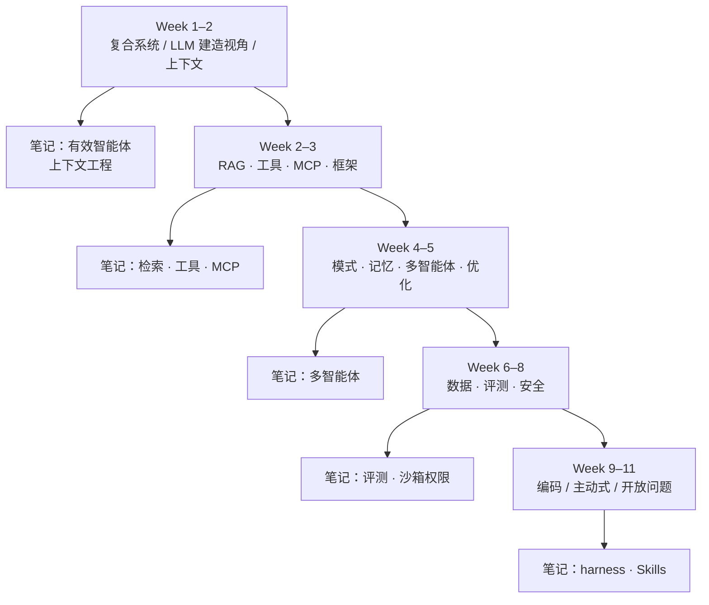

## 一句话导读

这是一门面向「怎么把智能体工程做扎实」的斯坦福课：先亲手搭 RAG、工具调用和智能体循环，再用 DSPy、LangGraph 等框架抽象，最后用作业和季度项目练优化与评测。公开站点能看到完整课表和阅读清单；本路线把它当作**选读骨架**，用来对照 Anthropic 工程笔记，而不是替换主线。

## 为什么放在这个阶段

- **入门末 / 体系初（Week 1–3）**：读完 [构建高效的智能体](./building-effective-agents.md) 之后，用本课的「智能体解剖 + RAG + 工具/MCP」补一门课级别的系统导览；上下文工程、[上下文检索](./contextual-retrieval.md)、[工具设计](./writing-tools-for-agents.md) 都有对应讲次。
- **体系中段（Week 4–5）**：设计模式、记忆架构、多智能体编排，正好对照 [多智能体研究系统](./multi-agent-research-system.md) 和记忆相关笔记。
- **体系后段（Week 5–8）**：优化（提示 vs 权重）、数据飞轮、评测四元组、LLM-as-judge、安全护栏——与 [揭秘 AI 智能体评测](./demystifying-evals-for-ai-agents.md) 同一主题，但更偏「一门课怎么教」。
- **实战（Week 9–11）**：编码智能体（SWE-agent / OpenHands / Claude Code 一类脚手架）、主动式智能体与开放问题，可对照 [长时任务 harness](./effective-harnesses-for-long-running-agents.md) 和 [Agent Skills](./equipping-agents-for-the-real-world-with-agent-skills.md)。
- **为什么是选读、不占主线步号**：主线 36 步已经够满；本课是完整学期强度（讲座 + 作业 + 项目）。公开材料适合「按主题跳读」，不必整学期跟完。

## 结构速览

课程页说明：周一、周三 13:30–14:50（太平洋时间），Skilling Auditorium；课表可能调整。下表按 **2026-10-28** 首页整理，内容为笔者概括。

| 周 | 主题（笔者概括） | 和本路线的关系 |
|---|---|---|
| 1 | 智能体是什么：LLM 核心、推理、记忆、工具、环境；复合系统 vs 工作流 vs 智能体；可靠性与评测挑战 | 对照 [构建高效的智能体](./building-effective-agents.md)；阅读含 BAIR「从模型到复合系统」、Lilian Weng 智能体综述 |
| 2 | 建造者视角的 LLM：解码、注意力与上下文长度、预训练到后训练、推理/测试时扩展、结构化输出、[上下文工程](./effective-context-engineering-for-ai-agents.md) | 与 Anthropic 上下文工程笔记同主题 |
| 2–3 | RAG 全链路：切分、检索（BM25/DPR/混合）、重排、ColBERT、Agentic RAG；常见失败 | 对照 [上下文检索](./contextual-retrieval.md) |
| 3 | 工具与函数调用：Toolformer / Gorilla / ToolLLM；REST → function calling → **MCP**；BFCL、ToolBench、τ-bench | 对照工具笔记与 [MCP + 代码执行](./code-execution-with-mcp.md) |
| 3 | 框架与编排：DSPy（签名、模块、优化器）、LangGraph；开源 harness（mini-SWE-agent、OpenHands、Pi）；Temporal；可观测性 | 框架选型与 harness 讨论 |
| 4 | 设计模式：工作流五模式；ReAct / Reflexion / CodeAct / ReWOO；上下文管理（事件日志、压缩、观察掩码、隔离）；Pi harness 案例 | 对照 Anthropic《Building effective agents》与 harness 笔记 |
| 4 | 记忆架构：工作/情节/语义/程序记忆；技能库、MemGPT 式分层、反思巩固、维护；遗忘与隐私 | 记忆系统设计清单 |
| 5 | 多智能体：编排器 / swarm / 混合；handoff、留言板、A2A；任务账本与隔离；失败原因 | 对照 [多智能体研究系统](./multi-agent-research-system.md) |
| 5 | 优化：少样本引导、MIPROv2、OPRO、TextGrad、GEPA；SFT / PPO / GRPO；何时优提示、何时优权重 | 生产迭代手段 |
| 6 | Guest：Terminal-Bench（终端环境真实任务基准） | 对照基准与脚手架思路 |
| 6–7 | 智能体需要的数据：轨迹、示范、反馈；飞轮与合成数据；筛选与小而精的基准 | 评测与训练数据同源 |
| 7–8 | 评测：请求–环境–停止条件–打分器四元组；LLM-as-judge 偏见；pass@k；Anthropic 评测路线图 | 对照 [揭秘 AI 智能体评测](./demystifying-evals-for-ai-agents.md) |
| 8 | 安全：工具隐私、提示注入（含间接）、红队、沙箱与权限、输出护栏、人在回路 | 对照沙箱与权限类笔记 |
| 9–11 | 编码智能体端到端；主动式智能体（GUM、下一步预测）；多模态/网页/科学智能体与生产可观测性 | 对照 harness、Skills、生产实践 |

作业与项目节点（课程页，太平洋时间）：项目提案、HW1/HW2、中期演示与报告、论文视频互评、期末演示。具体日期以[课程首页 Deadlines](https://cs329z.stanford.edu/)为准。

## 建议看哪些部分

| 优先级 | 部分 | 理由 |
|---|---|---|
| 必看（若只挑一轮） | Week 1 导论 + Week 3 工具/MCP + Week 4 设计模式 | 最快建立「复合系统 / 工作流 / 智能体」与工具接口的课级框架 |
| 必看 | Week 7–8 评测两讲 | 四元组与 judge 偏见，和评测笔记互为提纲 |
| 推荐 | Week 2 RAG + Week 4 记忆 + Week 5 多智能体 | 补齐检索、记忆、协作三条纵深 |
| 推荐 | Week 5 优化 + Week 6–7 数据 | 想做「提示/权重/数据飞轮」闭环时再看 |
| 按需 | Week 9–11 编码/主动式智能体、Guest Terminal-Bench | 正在做编码 agent 或长时任务时再深入 |
| 可略 | 仅斯坦福学籍能交的作业与项目细节 | 旁听公开材料够用；作业以官网为准 |

公开阅读清单里反复出现、且本路线已有导读或笔记可对照的，包括：Zaharia 等论复合 AI 系统、[Lilian Weng 智能体综述](./r-lilian-weng-llm-agents.md)、Anthropic 上下文工程与《Building effective agents》、MCP 规范、DSPy、ReAct、MemGPT、AutoGen、SWE-agent / OpenHands / SWE-bench 等——**优先读原论文/原博，再用本课幻灯片当导航**。

## 与 Anthropic 笔记对照

- **一致**：课程强调「先分解问题、选组件、建评测、再谈自主」；与 [构建高效的智能体](./building-effective-agents.md)「简单工作流优先」同调。工具失败模式、上下文工程、MCP 标准接口，与现有工具/MCP/上下文笔记同一问题空间。
- **互补**：课里系统讲 DSPy 优化器、GEPA、权重侧 RL（GRPO 等），Anthropic 工程博客更偏产品与 harness 实践——两边合看，一张是「课上的方法菜单」，一张是「线上怎么落地」。
- **评测**：四元组（请求、环境、停止条件、打分器）可直接当作读 [揭秘 AI 智能体评测](./demystifying-evals-for-ai-agents.md) 时的板书提纲；LLM-as-judge 偏见、pass@k 与 Anthropic 评测路线图在 Week 8。
- **多智能体与记忆**：编排失败、共享记忆、隔离工作区，可对照多智能体笔记里的成本与协调问题。
- **编码智能体**：SWE-agent / OpenHands / Claude Code 作为「脚手架即设计决策」，与 [长时 harness](./effective-harnesses-for-long-running-agents.md)、[Agent Skills](./equipping-agents-for-the-real-world-with-agent-skills.md) 同一条线。

## 学习任务

1. 只读 Week 1 幻灯片与 BAIR「复合 AI 系统」一文，用自己的话区分：**工作流 / 复合系统 / 自主智能体**，并指出你当前项目属于哪一类（对照[第 1 篇](./building-effective-agents.md)）。
2. 对照 Week 3 的工具接口演进（REST → 函数调用 → MCP），列出你常用栈里「工具描述写在哪、谁负责校验、失败如何重试」；缺的一环补进设计笔记。
3. 用 Week 7 的四元组，为你正在做的一个智能体任务写一页最小评测说明：请求集、环境、停止条件、打分器（规则 / 模型 / 人工选一种起步）。
4. 若你在做编码智能体：读 Week 9 相关阅读（SWE-agent / OpenHands）后，画一张「脚手架边界」图——哪些能力在模型外的 harness 里（对照 harness 与 Skills 笔记）。

## 注意事项

- **时效**：课表标注 tentative；幻灯片随堂挂出，个别日期可能还没有链接。阅读清单里的论文与博客年份跨度大，以课程页当期链接为准。
- **获取**：本导读依据[公开课程站](https://cs329z.stanford.edu/)。讲座录像、作业提交与学分政策**未在公开首页写清**，旁听能看到多少以站点实测为准。
- **作业与项目**：季度项目贯穿全期；没有学籍通常无法交作业，但不妨碍按课表自学公开阅读。
- **立场**：课程使用 DSPy、LangGraph、多种开源 harness 作演示，学习重点应放在可迁移的分解方式、评测与安全，而不是绑定某一框架。
- **版权**：不要整页复制幻灯片或阅读材料进仓库；本页只保留结构摘要与外链。
- **投入**：`estimated_hours: 40` 是笔者按「精读公开课表 + 核心阅读 + 对照本站笔记」估算的旁听强度；完整修课（作业 + 项目）会明显高于此，未单独估算。

## 核实记录

| 项 | 结果（2026-10-28） |
|---|---|
| 首页与课表 | 已打开 [cs329z.stanford.edu](https://cs329z.stanford.edu/)，按周次与 Deadlines 表核对 |
| 教师 | Diyi Yang、Michael Ryan、John Yang；TA 名单见首页 |
| 公开材料 | 课表中多数讲次有 Slides 栏；是否全部可下载未逐条点开 |
| 中文版 | **未查到**官方中文站点 |
| 与本站主线 | 设为 `optional: true`，不占用 1–36 主线步号 |
