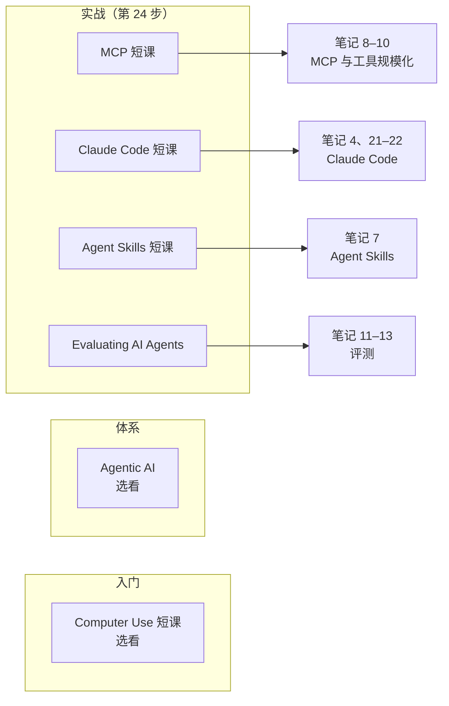

## 一句话导读

这是一组时长一到两小时的视频短课，由讲师带着 notebook 演示。本页只挑出与 Anthropic 工程博客主题一一对应的几门，作用是**把笔记里读到的东西“看一遍别人怎么动手”**。

## 为什么放在这个阶段

- **主阶段：实战**。读完两篇长时 harness 笔记后，MCP、Claude Code、Agent Skills 三门 Anthropic 合作短课正好提供动手演示；评测课则把体系阶段的评测理论落到 tracing 和实验上。
- **入门（选看）**：Computer Use 短课把 API、多模态、提示缓存、工具使用串成一个 computer use 示例，可以作为入门阶段的综合复习。
- **体系（选看）**：Andrew Ng 的 Agentic AI 是一门约 10 小时的系统课，覆盖反思、工具、评测与错误分析、规划与多智能体，适合想要一条完整视频主线的读者。

## 结构速览

| 课程 | 合作方 / 讲师 | 发布 | 时长（课程页） | 主要内容（笔者概括） |
|---|---|---|---|---|
| [Building toward Computer Use with Anthropic](https://www.deeplearning.ai/courses/building-toward-computer-use-with-anthropic) | Anthropic / Colt Steele | 2025-01-22 | 1h47m，9 个视频 | API 基础、多模态、真实场景提示、提示缓存、工具使用，最后组装 computer use |
| [Agentic AI](https://www.deeplearning.ai/courses/agentic-ai) | Andrew Ng | 2025-09-30（页面注明 2026-08-31 更新） | 9h55m，31 个视频 | 自主程度与任务分解、反思、工具与代码执行、评测与错误分析（含组件级评测、延迟与成本）、规划与多智能体通信模式 |
| [MCP: Build Rich-Context AI Apps with Anthropic](https://www.deeplearning.ai/courses/mcp-build-rich-context-ai-apps-with-anthropic) | Anthropic / Elie Schoppik | 2025-05-14 | 1h58m，11 个视频 | 为什么需要 MCP、架构、写服务器与客户端、参考服务器、prompts 与 resources、接入 Claude Desktop、远程服务器 |
| [Claude Code: A Highly Agentic Coding Assistant](https://www.deeplearning.ai/courses/claude-code-a-highly-agentic-coding-assistant) | Anthropic / Elie Schoppik | 2025-08-06 | 约 2 小时 | 安装与理解代码库、功能开发、测试调试重构、并行开发多个功能、GitHub 集成与 hooks、从 notebook 到仪表盘、从 Figma 到网页 |
| [Agent Skills with Anthropic](https://www.deeplearning.ai/courses/agent-skills-with-anthropic) | Anthropic / Elie Schoppik | 2026-01-28 | 2h19m，10 个视频 | 为什么需要 skills、skills 与工具/MCP/子智能体的区别、预置与自定义 skill、在 API、Claude Code、Agent SDK 中使用 |
| [Evaluating AI Agents](https://www.deeplearning.ai/courses/evaluating-ai-agents) | Arize / John Gilhuly、Aman Khan | 2025-02-19 | 2h36m，15 个视频 | 拆解智能体、tracing、路由与技能评测、轨迹评测、结构化实验、LLM 评判、上线监控 |

**备选**（只核实了标题、日期和简介，没看课时安排）：Building Coding Agents with Tool Execution（2025-12-03，沙箱中执行代码）、Agent Memory: Building Memory-Aware Agents（2026-03-18）、Spec-Driven Development with Coding Agents（2026-04-15）、AI Code Review（2026-07-29）、Governing AI Agents（2025-10-22，数据治理）。

## 建议看哪些部分

| 优先级 | 课程 | 理由 |
|---|---|---|
| 必看（实战） | Agent Skills with Anthropic | 与 [Agent Skills 笔记](./equipping-agents-for-the-real-world-with-agent-skills.md) 一一对应，而且专门讲 skills 与工具、MCP、子智能体如何分工 |
| 必看（实战） | Evaluating AI Agents | 把“轨迹评测”“组件评测”变成可操作的 tracing 和实验流程 |
| 推荐 | MCP 短课 | 读 [用代码执行调用 MCP](./code-execution-with-mcp.md) 和 [Desktop Extensions](./desktop-extensions.md) 之前没写过 MCP 服务器的读者，从这门课入手最快 |
| 推荐 | Claude Code 短课 | 与 [Claude Code 最佳实践](./claude-code-best-practices.md) 对照，看并行工作流、hooks 的实际操作 |
| 选看 | Computer Use 短课（入门）、Agentic AI（体系） | 前者用来复习，后者用来补系统视角 |
| 可略 | 备选短课 | 遇到具体需求（记忆、代码审查、治理）时再查 |

## 与 Anthropic 笔记对照

- **Skills**：短课讲“怎么用”，[Agent Skills 笔记](./equipping-agents-for-the-real-world-with-agent-skills.md) 讲“为什么这样设计”（渐进式披露）。看完课可以回头检查：课里的自定义 skill 是否符合笔记里的分层加载思路。
- **MCP**：短课演示协议本身；[用代码执行调用 MCP](./code-execution-with-mcp.md) 和 [高级工具使用](./advanced-tool-use.md) 讨论工具变多以后的上下文成本——这是短课不太涉及的“规模化”问题。
- **Claude Code**：短课偏操作演示；[Claude Code 最佳实践](./claude-code-best-practices.md)、[超越权限弹窗](./claude-code-sandboxing.md)、[auto 模式](./claude-code-auto-mode.md) 讲背后的取舍和安全边界。
- **评测**：Arize 课程的 tracing 与轨迹评测，可以和 [揭秘 AI 智能体评测](./demystifying-evals-for-ai-agents.md)、[基础设施噪声](./infrastructure-noise.md) 一起读——后者提醒“分数差异可能来自环境而非模型”。
- **Agentic AI**：课程中反思、工具、规划、多智能体几个模块，大致对应 [构建高效的智能体](./building-effective-agents.md) 的模式清单与 [多智能体研究系统](./multi-agent-research-system.md)；其中“错误分析”模块与评测笔记最互补。

## 学习任务

1. 看完 Agent Skills 短课后，把你常做的一件事写成一个 skill，再对照笔记检查：`description` 能否让模型判断何时加载？大文件有没有拆到按需读取的位置？
2. 看完 MCP 短课后，写一个只有两个工具的 MCP 服务器，然后思考：如果工具增加到 50 个，[用代码执行调用 MCP](./code-execution-with-mcp.md) 的做法能省下什么？
3. 用 Evaluating AI Agents 的方法，为你在 [Hugging Face 课程](./r-hf-agents-course.md)里做的结业智能体补一次轨迹评测。

## 注意事项

- **费用**：课程页写着证书或成就需要 PRO，**具体价格以及哪些内容免费都未核实**，本页不作说明。
- **时效**：Anthropic 合作短课录制于 2025–2026 年，界面和模型名可能已经变化，操作细节以 Claude 官方文档为准。
- **厂商视角**：评测课由 Arize 合作制作，会使用其工具。学习重点放在方法上，不必绑定特定平台。
- **URL**：旧的 `/short-courses/` 地址会跳转到 `/courses/`，本页统一使用新地址。

## 延伸阅读

**站内笔记**
- [用 Agent Skills 为智能体装备真实世界能力](./equipping-agents-for-the-real-world-with-agent-skills.md)
- [用代码执行调用 MCP](./code-execution-with-mcp.md)
- [Claude Code 最佳实践](./claude-code-best-practices.md)
- [揭秘 AI 智能体评测](./demystifying-evals-for-ai-agents.md)

**原文相关链接**
- 课程总目录：<https://www.deeplearning.ai/courses/>

---

*本导读依据 2026-10-17 访问的在线内容撰写，仅为导读与总结。原文：DeepLearning.AI, 课程目录及上述各课程页, <https://www.deeplearning.ai/courses/>。*
