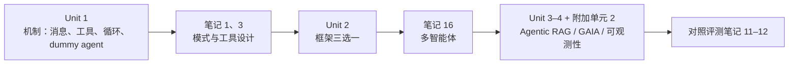

## 一句话导读

这是一门免费、动手为主的智能体课程。需要 Python 基础和基本的 LLM 常识。它的价值在于先把“智能体到底是怎么跑起来的”讲透，再带你用框架做出能拿基准分数的智能体。

## 为什么放在这个阶段

- **主阶段：入门（Unit 0–1）**。Anthropic 的[第 1 篇](./building-effective-agents.md)笔记讲的是“该用什么模式”，Unit 1 补的是“机制是什么”：消息格式与特殊 token、工具如何写进系统提示、“思考 → 行动 → 观察”循环、不依赖框架的手写 dummy agent。两者正好互补。
- **体系阶段末尾（Unit 2）**：读完检索、工具、MCP、评测几组笔记后，再看框架如何把解析器、记忆、重试等组件封装起来，并用多智能体一节衔接[第 16 篇](./multi-agent-research-system.md)。
- **实战阶段收尾（Unit 3–4 + 附加单元 2）**：做一个能在 GAIA 子集上计分、带可观测性的智能体，把整条路线的知识串起来。

## 结构速览

| 单元 | 内容（笔者概括） | 形式 |
|---|---|---|
| Unit 0 | 课程介绍、注册、Discord、选择旁听或认证路径 | 说明页 |
| Unit 1 | 什么是智能体、什么是 LLM、消息与特殊 token、工具、“思考 → 行动 → 观察”循环、ReAct 思路、dummy agent、用 smolagents 做第一个智能体 | 讲解 + 测验 + notebook |
| Unit 2 | 什么时候需要框架；2.1 smolagents（代码动作 vs JSON 动作、工具、检索智能体、多智能体、视觉与浏览器智能体）；2.2 LlamaIndex（组件、工具、智能体、工作流）；2.3 LangGraph（构建块、第一个图、文档分析图） | 讲解 + notebook |
| Unit 3 | Agentic RAG 用例：为虚构的晚会助手做检索工具、网页搜索等工具，再组装成智能体 | 项目式 |
| Unit 4 | 结业项目：介绍 GAIA 基准，用课程提供的 API 获取题目、提交答案、上排行榜（题目是 GAIA 验证集 level 1 中筛选的 20 题，按精确匹配评分） | 项目 + 排行榜 |
| 附加单元 1 | 为函数调用微调 LLM | 选修 |
| 附加单元 2 | 智能体可观测性与评测：trace 与 span，延迟、成本、错误、用户反馈等指标，离线评测与在线评测 | 选修，**推荐** |
| 附加单元 3 | 游戏中的智能体（宝可梦对战） | 选修 |

课程首页给出的节奏是每章约 1 周、每周 3–4 小时。frontmatter 里的 `estimated_hours: 20` 是笔者按主线五个单元估算的。

## 建议看哪些部分

| 优先级 | 部分 | 理由 |
|---|---|---|
| 必看 | [Unit 1 全部](https://huggingface.co/learn/agents-course/unit1/introduction)，尤其 [Dummy Agent Library](https://huggingface.co/learn/agents-course/unit1/dummy-agent-library) 和 [Thought-Action-Observation](https://huggingface.co/learn/agents-course/unit1/agent-steps-and-structure) | 不靠框架、用一个手写的系统提示把工具描述和循环规则交代清楚，最能建立直觉 |
| 必看 | [Unit 2 导言](https://huggingface.co/learn/agents-course/unit2/introduction) + 一个框架（建议 [2.1 smolagents](https://huggingface.co/learn/agents-course/unit2/smolagents/introduction)） | 导言明确说“很多场景不需要框架”，并列出框架要解决的组件（LLM 引擎、工具、解析器、记忆、重试），可以和 Anthropic “先用 API、少用框架”的观点对照 |
| 必看 | [Unit 4 结业项目](https://huggingface.co/learn/agents-course/unit4/introduction) | 第一次让自己的智能体接受基准打分，可以配合评测笔记理解精确匹配评分的局限 |
| 推荐 | [附加单元 2 可观测性与评测](https://huggingface.co/learn/agents-course/bonus-unit2/introduction) | 用 trace/span 的语言讲清线上监控和离线评测，是评测笔记的工程补充 |
| 选看 | [Unit 3 Agentic RAG](https://huggingface.co/learn/agents-course/unit3/agentic-rag/introduction) | 与上下文检索笔记一起看“检索作为工具” |
| 可略 | Unit 2 中另外两个框架、附加单元 1 和 3 | 按兴趣或团队技术栈选 |

## 与 Anthropic 笔记对照

- **一致**：Unit 1 的“思考 → 行动 → 观察”循环，就是 [构建高效的智能体](./building-effective-agents.md) 里“增强型 LLM 在循环中使用工具”的具体实现；Unit 2 导言“很多时候固定工作流就够了”，与该文“简单优先”的立场一致。
- **互补**：Unit 1 讲工具如何在系统提示里描述，[为智能体编写高效工具](./writing-tools-for-agents.md) 讲怎样把工具设计好、怎样用评测迭代工具。
- **可以讨论的差异**：smolagents 单元把“用代码作为动作”（code agents）放在 JSON 式 tool-calling 之前重点讲，与 [用代码执行调用 MCP](./code-execution-with-mcp.md) 的思路相近；但 Anthropic 也提醒代码执行需要沙箱（见 [超越权限弹窗](./claude-code-sandboxing.md)）。
- **多智能体**：Unit 2.1 的多智能体一节可以对照 [我们如何构建多智能体研究系统](./multi-agent-research-system.md) 中编排者与子智能体的分工，以及它对 token 成本的提醒。
- **评测**：Unit 4 按精确匹配评分、附加单元 2 区分离线和在线评测，可以对照 [揭秘 AI 智能体评测](./demystifying-evals-for-ai-agents.md) 中 grader 类型的讨论，以及 [SWE-bench 笔记](./swe-bench-sonnet.md) 中“脚手架本身也在被评测”的观点。

## 学习任务

1. 不用框架，照着 Unit 1 的思路，用你常用的模型 API 手写一个只有一个工具的循环；然后对照[第 1 篇](./building-effective-agents.md)笔记，判断它属于“工作流”还是“智能体”。
2. Unit 2 选定一个框架后，列出它替你做了哪些事（解析、重试、记忆……），再思考哪些地方你更希望自己掌控（可以带到实战阶段，与 [12-Factor Agents 导读](./r-12-factor-agents.md) 对照）。
3. Unit 4 提交一次后，挑三道失败的题，判断失败属于规划、工具还是答案格式问题（可以借用 [Chip Huyen 对失败模式的分类](./r-chip-huyen-agents.md)）。
4. 用附加单元 2 的指标清单，为你的结业智能体列一份最小监控方案。

## 注意事项

- **时效**：课程会持续更新，示例代码里的模型名和框架版本会变，以课程页面为准。
- **立场**：课程使用 Hugging Face 生态（Hub、Spaces、smolagents），这很自然；但学习重点应放在可迁移的概念上。
- **费用**：课程首页说明课程和认证流程免费。运行 notebook 时调用推理服务是否收费，取决于你使用的服务，本导读不作说明。
- **语言**：英文为原版，官方另有[简体中文版](https://huggingface.co/learn/agents-course/zh-CN/unit0/introduction)。

## 延伸阅读

**站内笔记**
- [构建高效的智能体](./building-effective-agents.md)
- [为智能体编写高效工具](./writing-tools-for-agents.md)
- [我们如何构建多智能体研究系统](./multi-agent-research-system.md)
- [揭秘 AI 智能体评测](./demystifying-evals-for-ai-agents.md)
- [上下文检索](./contextual-retrieval.md)

**原文相关链接**
- [课程源码与目录](https://github.com/huggingface/agents-course)
- [GAIA 论文页](https://huggingface.co/papers/2311.12983)

---

*本导读依据 2026-10-17 访问的在线内容撰写，仅为导读与总结。原文：Hugging Face,[《AI Agents Course》](https://huggingface.co/learn/agents-course)。*
