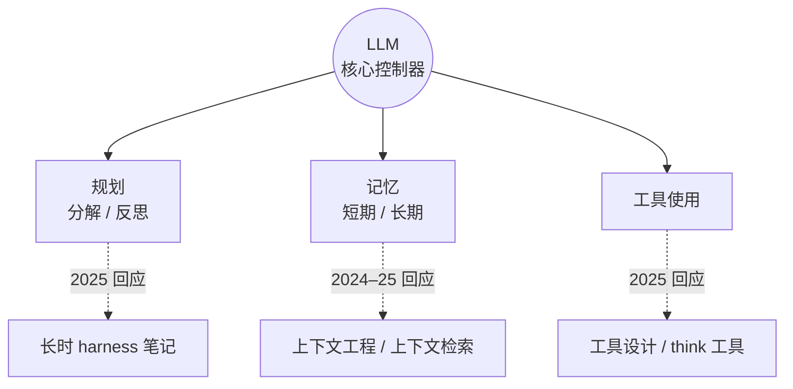

> **时效提示**：本文**写于 2023 年 6 月**。概念框架至今好用，但具体系统和能力判断已经过时，请当作“历史地图”来读。

## 一句话导读

这篇文章画出了一张很清晰的地图：**LLM 当大脑，外加规划、记忆、工具使用三个组件**。每个组件下面都列出了当时的代表方法。读完后，你会拥有一套词汇，用来给后面每篇 Anthropic 笔记“定位”。

## 为什么放在这个阶段

- 入门阶段已经用 [Hugging Face 课程](./r-hf-agents-course.md)和 Anthropic 前几篇笔记建立了直觉，**体系阶段的第一件事是搭框架**。这篇综述提供的就是框架。
- 放在 [Chip Huyen 那篇](./r-chip-huyen-agents.md)之前：Weng 偏“研究脉络”（2023），Huyen 偏“工程取舍”（2025）。按时间顺序读，能清楚看到领域的关注点如何从“组件有哪些”转向“怎么规划、怎么失败”。
- 文末列出的三大挑战，恰好是体系与实战阶段大部分 Anthropic 文章在回应的问题。

## 结构速览

| 部分 | 内容（笔者概括） |
|---|---|
| 系统总览 | LLM 作为核心控制器；规划（子目标分解、反思与改进）、记忆（短期 = 上下文内学习，长期 = 外部向量库）、工具使用（调用外部 API 获取模型缺少的信息或能力） |
| 组件一：规划 | 任务分解：思维链 CoT、思维树 ToT、借助外部经典规划器（LLM+P）；自我反思：ReAct（思考/行动/观察交替）、Reflexion、Chain of Hindsight、Algorithm Distillation |
| 组件二：记忆 | 借用人类记忆分类（感觉、短期、长期）类比到模型；最大内积搜索（MIPS）与常见近似最近邻算法（LSH、ANNOY、HNSW、FAISS、ScaNN 等） |
| 组件三：工具使用 | MRKL、TALM、Toolformer、ChatGPT 插件与函数调用、HuggingGPT、API-Bank 基准 |
| 案例研究 | 科学发现智能体（ChemCrow 等）、Generative Agents 模拟、AutoGPT / GPT-Engineer 等概念验证 |
| 挑战 | 上下文长度有限；长期规划与任务分解困难；自然语言接口不可靠 |

## 建议看哪些部分

| 优先级 | 部分 | 理由 |
|---|---|---|
| 必看 | [系统总览](https://lilianweng.github.io/posts/2023-06-23-agent/#agent-system-overview) | 整篇的骨架，一张图看懂三大组件 |
| 必看 | [规划](https://lilianweng.github.io/posts/2023-06-23-agent/#component-one-planning)中的任务分解与 ReAct、Reflexion | 后面讲“思考 → 行动 → 观察”和自我纠错时都会用到 |
| 必看 | [挑战](https://lilianweng.github.io/posts/2023-06-23-agent/#challenges) | 拿它和 2024–2026 年的 Anthropic 文章逐条对照 |
| 选看 | [记忆](https://lilianweng.github.io/posts/2023-06-23-agent/#component-two-memory)中的 MIPS 与 ANN 算法 | 做检索系统时再细看；配合上下文检索笔记阅读 |
| 可略 | 案例研究中 AutoGPT 等概念验证的提示词细节 | 历史价值大于实用价值 |

## 与 Anthropic 笔记对照

Weng 列出的三大挑战，后来的 Anthropic 文章基本都在回应：

| Weng 的挑战（2023） | 后续 Anthropic 文章的回应 |
|---|---|
| 上下文长度有限 | [上下文工程](./effective-context-engineering-for-ai-agents.md)：把上下文当作有限的“注意力预算”，用压缩、笔记、子智能体等手段管理；[上下文检索](./contextual-retrieval.md)：改进长期记忆的检索质量 |
| 长期规划困难 | [长时运行智能体的有效 harness](./effective-harnesses-for-long-running-agents.md)：用进度文件、功能清单和增量提交，让跨上下文窗口的工作能接续下去 |
| 自然语言接口不可靠 | [为智能体编写高效工具](./writing-tools-for-agents.md)：从工具命名、返回格式、错误信息入手提升可靠性；[think 工具](./claude-think-tool.md)：在工具调用链中给出明确的思考空间 |

另一处差异：Weng 把“记忆”当作独立组件。[构建高效的智能体](./building-effective-agents.md) 则把检索、工具、记忆统称为对 LLM 的“增强”，更强调**先用最简单的组合**。

## 学习任务

1. 把 Anthropic 已读的笔记逐篇放到 Weng 的三大组件下，看看有哪篇放不进去（比如评测、沙箱、事后复盘）。这说明 2023 年的框架缺了什么？
2. 用两三句话解释 ReAct 与 Reflexion 的区别，再说出 Hugging Face 课程 Unit 1 的循环更接近哪一个。
3. 对照上面的“挑战”表，为每条挑战再找一个本站以外、2025 年以后的做法（可以参考 [12-Factor Agents 导读](./r-12-factor-agents.md) 或 [OpenAI Cookbook 导读](./r-openai-cookbook.md)）。

## 注意事项

- **写于 2023 年**：文中“当前系统”“当前模型”指的是 2023 年的情况。上下文长度、工具调用可靠性等判断不能直接套用到今天。
- **研究视角**：文中很多方法来自论文，不等于生产实践。工程落地请以 Anthropic 文章和后续资源为准。
- 文章本身没有代码练习，适合配合笔记完成上面的任务。

## 关键原话

> "LLM functions as the agent's brain"
> （LLM 充当智能体的大脑）

## 延伸阅读

**站内笔记**
- [构建高效的智能体](./building-effective-agents.md)
- [面向 AI 智能体的上下文工程](./effective-context-engineering-for-ai-agents.md)
- [长时运行智能体的有效 harness](./effective-harnesses-for-long-running-agents.md)

**站内资源**
- 下一篇：[Chip Huyen《Agents》导读](./r-chip-huyen-agents.md)

---

*本导读依据 2026-10-17 访问的在线内容撰写，仅为导读与总结。原文：Lilian Weng,《LLM Powered Autonomous Agents》, 2023-06-23, <https://lilianweng.github.io/posts/2023-06-23-agent/>。*
