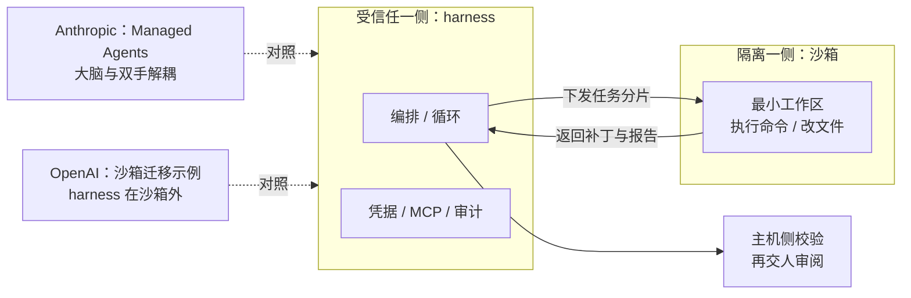

> **定位提示**：这一页不是“OpenAI 教程”，而是**对照材料**——看另一家厂商如何解决 Anthropic 文章里讨论的同一批问题。

## 一句话导读

Anthropic 工程博客讲“为什么这样设计”，OpenAI Cookbook 给的是“用自家 SDK 怎么搭出来”。两边对照读，能分清**哪些做法是行业共识，哪些是厂商特有的产品形态**。

## 为什么放在这个阶段

- 放在 [Managed Agents](./managed-agents.md) 之后：读完 Anthropic 如何把“大脑”（harness）和“双手”（沙箱）解耦，紧接着看 OpenAI 沙箱迁移示例中“harness 放在沙箱外”的同类思路，对比效果最好。
- 实战阶段已经有了 [12-Factor](./r-12-factor-agents.md) 的原则框架，再看两家厂商的具体实现，可以检验原则是否站得住。
- 之后进入沙箱和安全笔记（21–23），Cookbook 中关于信任边界的表格可以作为铺垫。

## 结构速览

Cookbook 的示例数量多、按标签组织，本页按主题精选如下（日期与作者取自各示例页）：

| 主题 | 示例 | 日期 / 作者 | 内容（笔者概括） |
|---|---|---|---|
| 记忆与压缩 | [Session memory](https://developers.openai.com/cookbook/examples/agents_sdk/session_memory) | 2025-09-09 / Emre Okcular | 短期记忆的两种策略：**截断**（只保留最近 N 轮）与**摘要**（最近几轮原样保留，更早的压成一段摘要）；比较两者优缺点；摘要提示应保留里程碑、检查矛盾、标注时间、控制幻觉；给出评测思路（与基线对比、LLM 评审、回放对话、token 压力测试） |
| 记忆与压缩 | [Context personalization](https://developers.openai.com/cookbook/examples/agents_sdk/context_personalization) | 2026-01-05 / Emre Okcular | 基于状态的长期记忆：把用户画像（结构化）和记忆笔记注入上下文，用工具在对话中记录新笔记，截断后重新注入，再异步合并去重、解决冲突；规定优先级（当前输入 > 会话 > 全局）；在提炼、合并、注入三处设护栏；给出记忆写入率、冲突率等指标 |
| 记忆与压缩 | [Building reliable agents with memory and compaction](https://developers.openai.com/cookbook/examples/agents_sdk/building_reliable_agents_memory_compaction) | 2026-05-01 / Wesley Pasfield、Emre Okcular | 以合成的合规调查为例：**压缩**让当前这次长任务能继续，**记忆**让以后的运行复用工作经验；关键原则是记忆只存流程经验、不存案件结论，结论写进需要人工审阅的备忘录 |
| 沙箱与 Skills | [Migrate a legacy codebase with sandbox agents](https://developers.openai.com/cookbook/examples/agents_sdk/sandboxed-code-migration/sandboxed_code_migration_agent) | 2026-04-07 / Konstantine Kahadze | **harness 放在沙箱外**：编排、凭据、MCP、审计留在受信任的主机进程，沙箱只拿到当前任务的代码和执行命令的能力；把迁移拆成按仓库分片的小任务，每片返回补丁和报告；更换沙箱提供方时只改创建沙箱的代码 |
| 沙箱与 Skills | [Skills in OpenAI API](https://developers.openai.com/cookbook/examples/skills_in_api) | 2026-02-10 / Emre Okcular | 以 `SKILL.md` 为入口的文件包；服务把 skill 的名称、描述和路径放进上下文，模型需要时再读全文、执行脚本；讨论系统提示、工具、skills 三者的分工；提到 frontmatter 校验遵循 Agent Skills 规范 |
| 评测与改进 | [Agent improvement loop](https://developers.openai.com/cookbook/examples/agents_sdk/agent_improvement_loop) | 2026-05-12 / Wesley Pasfield | 改进飞轮：trace → 人工和模型反馈 → 自动生成 Promptfoo 评测 → 用名为 HALO 的分析步骤给 harness 改动排序 → 交给 Codex 实现；可以选择人工把关的程度 |
| 评测与改进 | [Macro evals for agentic systems](https://developers.openai.com/cookbook/examples/partners/macro_evals_for_agentic_systems/macro_evals_for_agentic_systems) | 2026-05-19 / Shikhar Kwatra 等（与 Slalom 合作） | 区分**低层评测**（单次运行、单个智能体或交接）和**宏观评测**（跨大量 trace 聚类出反复出现的行为模式），再顺着因果图定位可疑的上游智能体，引导人类优先查看高影响模式；使用预先计算好的合成数据 |
| 成本优化 | [Optimizing customer support agents for cost and quality](https://developers.openai.com/cookbook/examples/agent_optimization/optimizing_agents_for_cost_and_quality) | 2026-09-14 / Emre Okcular、Lara Rachidi | 先测基线，每次只改一处，质量达标后才接受节省；建议顺序：提示与输出控制 → 工具控制 → 上下文清理 → 模型路由 → 提示缓存 → 拆分同步与异步工作 → 处理档位；默认是不调用 API 的模拟，数字不代表生产基准 |
| 历史（已归档） | [Orchestrating agents: routines and handoffs](https://developers.openai.com/cookbook/examples/orchestrating_agents) | 2024-10-10 / Ilan Bigio | 用“例程”（系统提示 + 工具）和“交接”（返回另一个智能体的函数）实现多智能体编排，配套示例库 Swarm（作者注明仅供示例）；页面标注已归档 |
| 历史（已归档） | [How to call functions with chat models](https://developers.openai.com/cookbook/examples/how_to_call_functions_with_chat_models) | 2023-06-13 / Colin Jarvis、Joe Palermo | Chat Completions 函数调用基础：API 只生成参数、不执行函数；强制或禁止调用；并行调用；页面标注已归档 |

## 建议看哪些部分

| 优先级 | 示例 | 理由 |
|---|---|---|
| 必看 | Sandboxed code migration | 与 Managed Agents 的“大脑与双手解耦”最直接对应，包含一张信任边界表 |
| 必看 | Memory and compaction | “压缩 vs 记忆”的分工讲得很清楚，可以与上下文工程笔记逐条对照 |
| 必看 | Agent improvement loop **或** Macro evals（二选一） | 前者是单个智能体的改进闭环，后者是多智能体系统的群体分析 |
| 推荐 | Skills in OpenAI API | 看同一个 `SKILL.md` 概念在另一家平台上的样子 |
| 推荐 | Cost and quality | 一份可以照着做的“降本不降质”流程 |
| 选看 | Session memory、Context personalization | 记忆策略的细节和指标 |
| 可略 | 两篇已归档示例 | 了解演进脉络即可；Swarm 与早期函数调用写法已被新 SDK 取代 |

## 与 Anthropic 笔记对照

| 问题 | Anthropic 笔记 | OpenAI Cookbook | 异同 |
|---|---|---|---|
| 上下文变长怎么办 | [上下文工程](./effective-context-engineering-for-ai-agents.md)：压缩、结构化笔记、子智能体 | Session memory（截断 / 摘要）、Memory and compaction | **共识**：都区分“当前任务的压缩”和“跨任务的记忆”。OpenAI 示例更明确地规定**记忆不能存事实结论**，结论要进人工审阅的产物 |
| 长期记忆 | [上下文工程](./effective-context-engineering-for-ai-agents.md) 中的笔记与记忆、[长时 harness](./effective-harnesses-for-long-running-agents.md) 的进度文件 | Context personalization：画像 + 笔记 + 异步合并 + 优先级规则 | **互补**：OpenAI 给出了可度量的记忆指标和三处护栏，Anthropic 文章更侧重原理 |
| harness 与执行环境的边界 | [Managed Agents](./managed-agents.md)、[超越权限弹窗](./claude-code-sandboxing.md)、[我们如何在各产品中约束 Claude](./how-we-contain-claude.md) | Sandboxed code migration：harness 在沙箱外，凭据和审计留在主机 | **高度一致**：两家都把编排与凭据放在受信任一侧，沙箱只给最小工作区 |
| 可复用的流程包 | [Agent Skills](./equipping-agents-for-the-real-world-with-agent-skills.md) | Skills in OpenAI API | **共识正在形成**：OpenAI 示例同样以 `SKILL.md` + frontmatter 为核心，并说明校验遵循 Agent Skills 规范 |
| 评测驱动改进 | [揭秘 AI 智能体评测](./demystifying-evals-for-ai-agents.md)、[为智能体编写高效工具](./writing-tools-for-agents.md) | Agent improvement loop、Macro evals | **一致**：都主张从真实 trace 出发、把反馈固化成评测。OpenAI 示例进一步把“生成评测”和“提出修改”也交给模型 |
| 成本与 token | [高级工具使用](./advanced-tool-use.md)、[用代码执行调用 MCP](./code-execution-with-mcp.md) | Cost and quality | **角度不同**：Anthropic 从工具定义和结果占用的上下文入手省 token；OpenAI 示例从全流程（路由、缓存、同步/异步拆分）入手，并强调质量门槛 |
| 多智能体编排 | [构建高效的智能体](./building-effective-agents.md)（路由、编排者—执行者）、[多智能体研究系统](./multi-agent-research-system.md) | Orchestrating agents（已归档） | 交接（handoff）思路与路由模式相近；Swarm 已标注仅供示例 |

## 学习任务

1. 选一个主题（记忆、沙箱或评测），各用一段话写出 Anthropic 和 OpenAI 的做法，再列出两家的一个共识和一个分歧。
2. 照着 Cost and quality 的顺序，给你的结业智能体做一次“只改一处”的优化实验，并用质量门槛决定是否接受。
3. 把 Memory and compaction 中“记忆只存流程经验”的原则，套用到你自己的智能体上，写出记忆写入规则。

## 注意事项

- **厂商视角**：示例是为了展示 OpenAI 自家的 SDK 和 API，引用的是 OpenAI 的模型名和产品功能，本导读只对比做法，不比较模型优劣。
- **时效**：示例更新频繁；模型名、API 参数可能很快变化，以页面为准。旧示例会标注 archived。
- **费用**：部分示例默认离线运行，不会产生费用（如成本优化示例和宏观评测示例）；其余需要 API key。具体价格本导读不写。
- **其他**：Cookbook 的 Evals 标签下有《Moving from OpenAI Evals to Promptfoo》（2026-06-03），Agents 标签下有《Migrate from the Claude Agent SDK to the OpenAI Agents SDK》（2026-05-07）。两篇都没有细读，本导读不作评价。

## 关键原话

> "context helps the agent work, memory helps future agents work better, and reviewed artifacts hold the facts"
> （上下文帮智能体干活，记忆帮以后的智能体干得更好，经过审阅的产物才承载事实。）——出自 Memory and compaction 示例

## 延伸阅读

**站内笔记**
- [扩展 Managed Agents](./managed-agents.md)
- [面向 AI 智能体的上下文工程](./effective-context-engineering-for-ai-agents.md)
- [用 Agent Skills 为智能体装备真实世界能力](./equipping-agents-for-the-real-world-with-agent-skills.md)
- [揭秘 AI 智能体评测](./demystifying-evals-for-ai-agents.md)

**站内资源**
- [12-Factor Agents 导读](./r-12-factor-agents.md)

---

*本导读依据 2026-10-17 访问的在线内容撰写，仅为导读与总结。原文：OpenAI,《OpenAI Cookbook》及上述各示例页, <https://developers.openai.com/cookbook>。*
