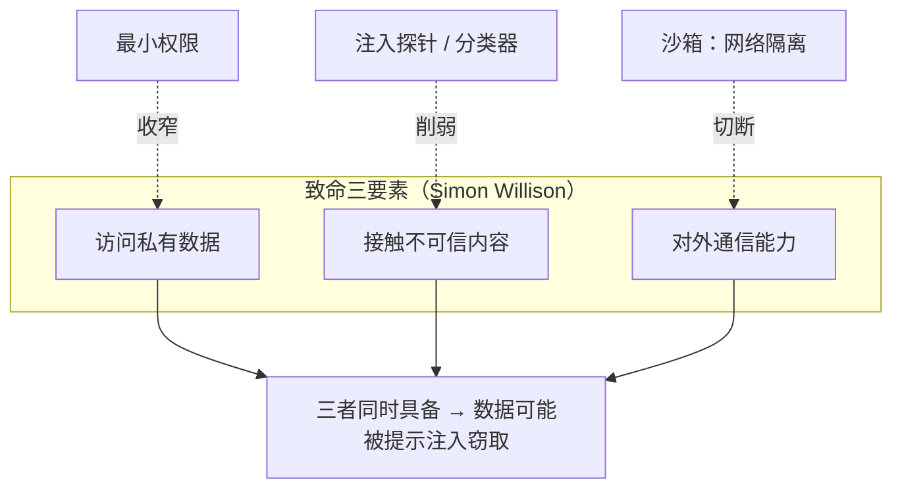

## 一句话导读

如果想在读完 Anthropic 笔记之后，继续跟一位**独立、动手、持续更新**的实践者看行业动态，Simon Willison 是很好的选择。但他写得太多，**只从下面几个入口进**就够了。

## 为什么放在这个阶段

- **前沿阶段**是“长期跟踪”阶段。前三个阶段建立的是体系，这里需要的是一个**节奏快、观点鲜明、横跨多家厂商**的信息源。
- 放在 [重新设计源代码控制](./redesigning-source-control.md) 之后：那篇讲的是智能体大量写代码对工程基础设施的冲击，而 Simon 的指南正好从个人工程师的角度讨论“写代码变便宜以后，习惯该怎么变”。
- 他对提示注入的长期追踪，是对 Anthropic 安全与约束笔记最好的外部补充。

## 结构速览

| 入口 | 是什么（笔者概括） |
|---|---|
| [Agentic Engineering Patterns](https://simonwillison.net/guides/agentic-engineering-patterns/) | 一份持续更新的指南，讲怎样用好 Claude Code、Codex 这类编码智能体。分为原则（写代码变便宜了、积累“会做的事”、用 AI 提升代码质量、反模式）、与编码智能体协作（工作原理、Git、子智能体）、测试与 QA（红/绿 TDD、先跑测试、智能体手动测试）、理解代码（线性走读、交互式解释）、带注释的提示示例等部分 |
| [The lethal trifecta](https://simonwillison.net/2025/Jun/16/the-lethal-trifecta/)（2025-06-16） | 提出“致命三要素”：**能访问私有数据 + 会接触不可信内容 + 能向外通信**。三者同时具备时，攻击者可以通过提示注入让智能体把数据泄露出去。作者认为唯一稳妥的办法是避免三者同时出现，并区分了“提示注入”和“越狱” |
| [“agent” 的定义](https://simonwillison.net/2025/Sep/18/agents/)（2025-09-18） | 作者收集了大量定义后，决定采用“在循环中运行工具以达成目标”这一说法，并指出 Anthropic 也采用类似定义 |
| 标签页：[coding-agents](https://simonwillison.net/tags/coding-agents/)、[prompt-injection](https://simonwillison.net/tags/prompt-injection/) | 长期跟踪用。2026-10-17 所见分别约 259 篇和 163 篇；相关标签还有 [lethal-trifecta](https://simonwillison.net/tags/lethal-trifecta/)、[ai-agents](https://simonwillison.net/tags/ai-agents/) |

## 建议看哪些部分

| 优先级 | 部分 | 理由 |
|---|---|---|
| 必看 | 指南中的 [How coding agents work](https://simonwillison.net/guides/agentic-engineering-patterns/how-coding-agents-work/)、[Anti-patterns](https://simonwillison.net/guides/agentic-engineering-patterns/anti-patterns/)、[Red/green TDD](https://simonwillison.net/guides/agentic-engineering-patterns/red-green-tdd/)、[First run the tests](https://simonwillison.net/guides/agentic-engineering-patterns/first-run-the-tests/) | 短小、可以马上用：比如“不要把自己没审过的智能体代码甩给同事审”，以及用测试约束智能体 |
| 必看 | [The lethal trifecta](https://simonwillison.net/2025/Jun/16/the-lethal-trifecta/) | 一个容易记住的安全检查清单，适合用来审视你搭的任何智能体 |
| 推荐 | 指南中的 [Writing code is cheap now](https://simonwillison.net/guides/agentic-engineering-patterns/code-is-cheap/) | 讨论代码成本骤降后，工程习惯和取舍该怎么调整 |
| 选看 | [agent 定义一文](https://simonwillison.net/2025/Sep/18/agents/) | 帮你在交流中统一术语 |
| 持续跟踪 | coding-agents 与 prompt-injection 标签页（或订阅其 newsletter） | 按周浏览即可，不必每篇都读 |
| 可略 | 博客其他大量主题（工具发布、个人项目等） | 与本路线关系不大 |

## 与 Anthropic 笔记对照

- **编码智能体实践**：指南中“先跑测试”“红/绿 TDD”“用 Git 管理智能体改动”与 [Claude Code 最佳实践](./claude-code-best-practices.md) 中的测试驱动、探索—计划—编码工作流高度一致。不同的是，Simon 的建议跨工具，不限于 Claude Code。
- **反模式与源码管理**：Simon 反对提交未经自己审阅的大量智能体代码，主张拆成小 PR；[重新设计源代码控制](./redesigning-source-control.md) 则从组织和基础设施层面应对智能体带来的提交量激增。两篇可以对照读。
- **提示注入与约束**：“致命三要素”给出的是威胁模型；Anthropic 的 [超越权限弹窗](./claude-code-sandboxing.md)（文件系统 + 网络隔离）、[auto 模式](./claude-code-auto-mode.md)（输入层的注入探针）、[我们如何在各产品中约束 Claude](./how-we-contain-claude.md) 展示的是缓解手段。可以试着用三要素逐一检查：每种手段切断了哪一条？
- **定义**：Simon 的“在循环中运行工具以达成目标”，与 [构建高效的智能体](./building-effective-agents.md) 中对智能体的描述一致。

图解：访问私有数据、接触不可信内容、对外通信能力三者同时具备时，提示注入就可能窃取数据；沙箱的网络隔离、注入探针或分类器、最小权限分别削弱其中一环。

## 学习任务

1. 用“致命三要素”审视你在实战阶段搭的智能体：三条各占了吗？如果都占了，参照 Anthropic 沙箱笔记，设计一种切断其中一条的方案。
2. 下次用编码智能体时，开局先让它“跑一遍测试”，再用红/绿 TDD 完成一个小功能，记录与平时相比的差别。
3. 每周花 20 分钟浏览 coding-agents 标签页，挑一条与某篇 Anthropic 笔记相关的动态，写两三句对照笔记。

## 持续跟进清单（路线第 36 步）

这是读完全部笔记和资源之后的长期习惯，频率是笔者的建议：

| 频率 | 做什么 |
|---|---|
| 每周 | 浏览 [coding-agents](https://simonwillison.net/tags/coding-agents/) 和 [prompt-injection](https://simonwillison.net/tags/prompt-injection/) 标签页的新文章，挑一条与已有笔记相关的写两三句对照 |
| 每月 | 查看 [Anthropic 工程博客](https://www.anthropic.com/engineering) 有没有新文章，有就按本站笔记模板补一篇，并考虑放进哪个阶段 |
| 每季度 | 复查各资源导读的 `last_checked` 和 `status`：[Hugging Face 课程](./r-hf-agents-course.md)是否改版、[OpenAI Cookbook](./r-openai-cookbook.md) 示例是否归档、[DeepLearning.AI](./r-deeplearning-ai-short-courses.md) 有没有新的相关短课 |
| 随时 | 遇到新的安全事件，用“致命三要素”过一遍，对照 [我们如何在各产品中约束 Claude](./how-we-contain-claude.md) |

## 注意事项

- **个人博客**：观点鲜明、更新快，部分是短评和链接摘录，不等于系统论述。
- **赞助内容**：首页和文章页顶部有赞助商信息，与正文观点无关，请注意区分。
- **数字会变**：标签下的文章数只是访问当天的快照。
- 本页只推荐入口，不代表博客其他内容未经筛选就可以直接采信。

## 关键原话

> "An LLM agent runs tools in a loop to achieve a goal."
> （LLM 智能体就是在循环中运行工具、以达成某个目标。）

## 延伸阅读

**站内笔记**
- [Claude Code 最佳实践](./claude-code-best-practices.md)
- [超越权限弹窗](./claude-code-sandboxing.md)
- [在 Anthropic 重新设计源代码控制](./redesigning-source-control.md)

**站内资源**
- [12-Factor Agents 导读](./r-12-factor-agents.md)：第 7、8 条人工介入与控制流

---

*本导读依据 2026-10-17 访问的在线内容撰写，仅为导读与总结。原文：Simon Willison,[《Simon Willison's Weblog》](https://simonwillison.net/)及上述文章与指南。*
